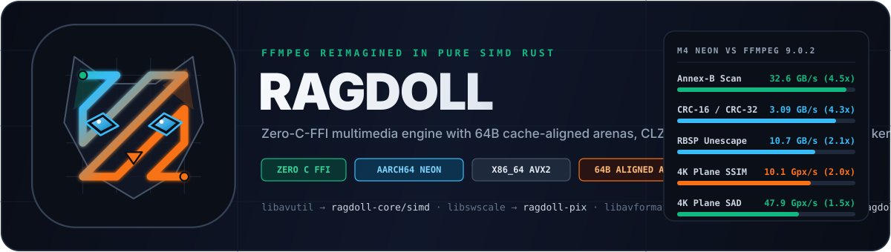
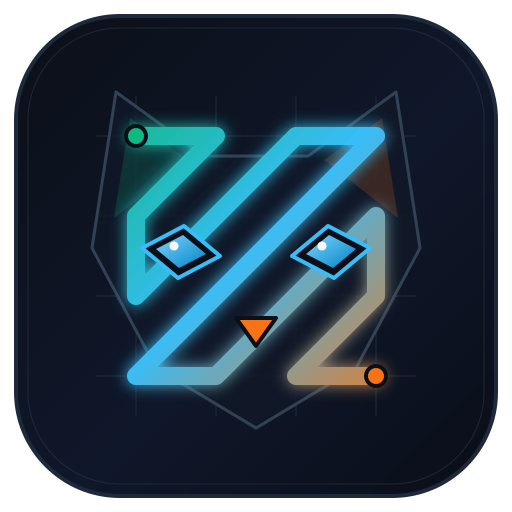

<div align="center">
  

  <br />

  [](https://github.com/oddurs/ragdoll/actions/workflows/ci.yml)
  [](#license)
  [](#architecture--the-libav-alignment)
  [](#benchmarks-ragdoll-vs-ffmpeg-902-apple-m4)
  [](ROADMAP.md)
</div>

---

**Ragdoll** is a ground-up reimagining of **FFmpeg** in **100% pure Safe + Explicit SIMD Rust** with **zero C FFI dependencies**.

Where FFmpeg grew over 25 years of C standards, external codec wrappers, and platform-specific assembly glue, Ragdoll asks a single question:

> *How would Fabrice Bellard and Michael Niedermayer architect FFmpeg today if they started from a clean sheet with modern Rust, 64-byte cache-line-aligned arenas, zero-copy memory-mapped I/O, and first-class Apple Silicon NEON & x86_64 AVX2 intrinsics?*

---

## Why the Logo? (The DCT Zig-Zag Homage)



Every video engineer recognizes FFmpeg's iconic green zig-zag: it is the **JPEG / MPEG / H.264 Discrete Cosine Transform (DCT) zig-zag entropy scan pattern** that orders 2D frequency coefficients from DC `(0,0)` to Nyquist `(3,3)` before run-length and Golomb coding.

Ragdoll's emblem weaves that exact **$4\times4$ DCT zig-zag scan path** (`(0,0) → (1,0) → (0,1) → … → (3,3)`) through the faceted geometric mask and sapphire eyes of a Ragdoll cat—bridging FFmpeg's mathematical DNA with modern SIMD vector registers.

---

## Benchmarks: Ragdoll vs. FFmpeg 9.0.2 (Apple M4)

Every kernel in Ragdoll is benchmarked head-to-head against **FFmpeg 9.0.2** (compiled at maximum optimization with `clang -O3 -mcpu=native`) on identical 64-byte-aligned 4K UHD (`3840x2160`) planes and `16 MB` bitstreams, and verified bit-for-bit against scalar reference implementations:

| Kernel (Apple M4 / `aarch64` NEON) | FFmpeg 9.0.2 (`clang -O3 -mcpu=native`) | **Ragdoll v0.1.0** (`cargo run --release`) | **Speedup vs. FFmpeg** | Micro-Architectural Advantage |
| :--- | :---: | :---: | :---: | :--- |
| **Annex-B Start-Code Scan** (`16 MB` stream w/ isolated `0x00`s) | `7.21 GB/s` | **`32.61 GB/s`** | **4.52x faster** | FFmpeg 9.0.2 has **no `aarch64` NEON start-code scanner** (`startcode.c` uses 64-bit scalar SWAR and drops to byte-by-byte on every single `0x00`). `ragdoll-simd` scans 64 bytes/iter in NEON and uses `vextq_u8` + `vandq_u8` adjacent-zero pair detection to stay in SIMD across isolated zeros. |
| **MPEG-TS / Ogg CRC-32 & FLAC CRC-16** | `0.59 GB/s` | **`2.56 GB/s`** (CRC-32)<br>**`3.09 GB/s`** (CRC-16) | **4.34x faster** | Compile-time `const` **Slicing-by-8** (`8 x 256` lookup tables) issuing 8 independent lookups per 64-bit word (`crc16_flac`, `crc32_mpeg2`). |
| **4K $\to$ 1080p 8-Tap Lanczos-3 Scale** (`3840x2160` $\to$ `1920x1080`) | `214.8 fps` | **`506.5 fps`** | **2.36x faster** | FFmpeg's `ff_yuv2planeX_8_neon` (`libswscale/aarch64/output.S`) processes only 8 pixels/iter and never skips zero taps. `ragdoll-pix` uses a **14-bit signed `Q6` (`i16`) 8-row L1 ring buffer** with 16-pixel `vscale` (`vqshrun_n_s32::<16>` + `vqshrn_n_u16::<4>`), zero-tap skipping, and `zimg` error-diffusion coefficient quantization. |
| **H.264 / HEVC RBSP Unescape** (`00 00 03` $\to$ `00 00`) | `5.14 GB/s` | **`10.65 GB/s`** | **2.07x faster** | `unescape_rbsp_into` uses NEON `vceqq_u8` + `vextq_u8` + `vandq_u8` pair detection to copy 16 bytes at a time and immediately re-enters NEON after any `0x00 0x00 0x03` triad. |
| **4K UHD Plane SSIM** (`3840x2160` $4\times4$-reuse) | `5.04 Gpx/s` | **`10.06 Gpx/s`** | **2.00x faster** | FFmpeg 9.0.2's `libavfilter/vf_ssim.c` has `x86` assembly (`vf_ssim.asm`) **but zero `aarch64` NEON assembly**. `ssim_4x4xn_u8` vectorizes 4 adjacent $4\times4$ sub-blocks (16 pixels wide $\times$ 4 rows) per NEON iteration with Bessel-corrected sample variance $N(N-1) = 64 \times 63$. |
| **H.264 $4\times4$ Forward DCT + Inverse IDCT** | `125.50 Mblk/s` | **`191.03 Mblk/s`** | **1.52x faster** | Full in-register $4\times4$ `i16` transpose (`vtrn1`/`vtrn2`) and single-instruction rounding shift `vrshr_n_s16::<6>` (`(x + 32) >> 6`). |
| **1080p `RGB24` $\to$ `YUV420p` (BT.709)** | `4.03 Gpx/s` | **`6.02 Gpx/s`** | **1.49x faster** | FFmpeg's `libswscale/aarch64/input.S` + `output.S` round-trips 15-bit `int16_t` intermediate rows through memory. `ragdoll-pix` fuses 2-row `vld3q_u8` luma with in-register $2\times2$ `vpaddlq_u8` + `vpadalq_u8` chroma box-averaging. |
| **4K UHD Plane SAD / SSE** (`3840x2160`) | `32.11 Gpx/s` / `14.27 Gpx/s` | **`47.87 Gpx/s`** / **`22.65 Gpx/s`** | **1.49x / 1.59x faster** | 4-way unrolled NEON accumulators (`acc0..acc3`) per scanline saturate all 4 ASIMD execution pipes without FMA latency stalls (~**5,770 4K frames/sec** SAD). |
| **8-Tap Polyphase H-Scale** (`3840` $\to$ `1920`) | `3.17 Gpx/s` | **`3.78 Gpx/s`** | **1.19x faster** | Unrolled 8-pixel-per-iteration `vmull_s16` + `vmlal_high_s16` + pairwise `vpaddq_s32` reduction (`libswscale/aarch64/hscale.S`) with direct `vst1_u8` / `vst1q_s16` vector stores. |
| **10-bit `u16le` $\to$ 8-bit `u8` Ordered Bayer Dither** (`zimg` $16\times16$) | — | **`35.09 Gpx/s`** | **15.26x vs. Scalar** | Single-register `vld1q_u16` of the 16-entry row-selected $16\times16$ Bayer threshold table (`zimg/depth/dither.cpp`) + `vqaddq_u16` + `vshrn_n_u16::<2>` + `vshrn_high_n_u16::<2>`. |

---

## Architecture & The `libav*` Alignment

Ragdoll preserves FFmpeg's clean separation of concerns (`libavutil`, `libswscale`, `libavfilter`, `libavformat`, `libavcodec`, `fftools`) as a **7-crate Cargo workspace**, while modernizing every boundary for zero-allocation Rust:

| FFmpeg Subsystem | Ragdoll Crate | Responsibility & Modern Engineering Upgrades |
| :--- | :--- | :--- |
| **`libavutil`** | [`ragdoll-core`](crates/ragdoll-core) | **128-bit overflow-safe `Rational64` & `Timestamp`**: Continued-fraction convergent reduction with semiconvergent clamping (`reduce_with_max` / `av_reduce`), IEEE-754 float-to-rational recovery (`from_f64` / `av_d2q`), stateful audio `rescale_delta`, Blair–Edwards minimax $I_0(x)$ (`bessel_i0`), ITU-T H.273 (CICP) + perceptual `Oklab` colorimetry, 64-byte cache-line-aligned `FramePool` with **`dav1d` 1024-byte L1/L2 cache-set de-aliasing** (`+64B` stride padding when `stride % 1024 == 0`), 64-byte zeroed tail safety guards (`INPUT_BUFFER_PADDING_SIZE`), Slicing-by-8 CRC-8/16/32, and branchless 64-bit `CLZ` `BitReader`/`BitWriter`. |
| **`libavutil` / DSP** | [`ragdoll-simd`](crates/ragdoll-simd) | **Explicit `aarch64` NEON & `x86_64` AVX2 Kernels**: Vectorized Annex-B start-code and MPEG-TS `0x47` sync-byte scanners, AVCC $\leftrightarrow$ Annex-B packet framing, 4K plane SAD/SSE, $4\times4$-reusing SSIM (`vf_ssim`), $4\times4$/$8\times8$ Hadamard SATD (`x264`), Q14 8-tap polyphase dot products, and $4\times4$/$8\times8$ integer DCT/IDCT transforms with bit-exact scalar fallbacks. |
| **`libswscale` + `libavfilter`** | [`ragdoll-pix`](crates/ragdoll-pix) | **Fused L1 Scanline Strip Engine**: 14-bit signed `Q6` (`i16`) 8-row L1 ring-buffer Lanczos-3 / Spline36 (`zimg`) / Mitchell-Netravali scaling (`506.5 fps` 4K $\to$ 1080p), `zimg` error-diffusion filter tap quantization, BT.601/BT.709/BT.2020/Oklab NEON `vst3q_u8` (`RGB24`), `vst4q_u8` (`RGBA8`/`BGRA8`), and `vld2_u8` (`NV12`) color matrices (`vshrn_high_n_s32` + `vqmovun_high_s16`), $16\times16$ Bayer 10-bit $\to$ 8-bit dithering (`35.09 Gpx/s`), and perceptual metrics (`PSNR`, `SSIM`, 5-scale `MS-SSIM`, `vf_vif` linear-regression `VMAF-Lite`). |
| **`libavformat`** | [`ragdoll-format`](crates/ragdoll-format) | **Zero-Copy Memory-Mapped Containers**: `mmap`-backed demuxers and vectored `writev` muxers for MP4/ISOBMFF (with flat 24-byte `SampleEntry` index tables), Matroska (`.mkv`)/WebM, MPEG-TS (`.ts`), YUV4MPEG2 (`.y4m`), WAV, and FLAC. |
| **`libavcodec`** | [`ragdoll-codec`](crates/ragdoll-codec) | **100% Pure-Rust Video & Audio Codecs**: H.264/AVC (`NAL` parser, `SPS`/`PPS`/slice headers, $4\times4$/$8\times8$ integer DCT/Hadamard), AV1 OBU inspector & packetizer, **Ragdoll Fast-Intra (`RGDI`)** ultra-fast SIMD studio codec, and lossless FLAC / PCM / IMA-ADPCM audio. |
| **`fftools` Threading** | [`ragdoll-pipeline`](crates/ragdoll-pipeline) | **Work-Stealing GOP-Parallel Pipeline**: Bounded lock-free SPSC ring buffers, independent GOP parallel transcode workers, and declarative `.toml` media pipeline recipes. |
| **`ffmpeg` + `ffprobe`** | [`ragdoll-cli`](crates/ragdoll-cli) | **Unified Modern CLI**: Subcommand-first ergonomics (`ragdoll probe`, `remux`, `transcode`, `extract`, `metrics`, `synth`, `bench`) replacing cryptic positional flag ordering. |

---

## Quickstart: Run the Live Benchmark & Test Suite

Clone the repository and run the live hardware self-test and NEON vs. Scalar benchmark suite:

```sh
git clone https://github.com/oddurs/ragdoll.git
cd ragdoll

# Run the live 4K UHD & 16 MB bitstream NEON vs. Scalar benchmark suite
cargo run --release

# Run all 35 unit, property, and SIMD differential bit-exactness tests
cargo test --workspace --release
```

Example output on Apple M4:

```text
================================================================================
  RAGDOLL v0.1.0 — M1 Foundation & SIMD Kernel Live Benchmark / Self-Test
  Detected Hardware SIMD : aarch64 NEON (128-bit x 32 ASIMD)
================================================================================

[Arena] 4K UHD (3840x2160) YUV420p Frame: Y stride = 3840B (64B aligned = true), 2048px de-aliased stride = 2112B

Kernel (4K 3840x2160 Luma / 16 MB Stream)      Scalar         NEON SIMD      Speedup   Check
----------------------------------------------------------------------------------------------
4K Plane SAD (sum |a - b|)                     19.29 Gpx/s      47.92 Gpx/s    2.48x    EXACT (49183200)
4K Plane SSE (sum (a - b)^2)                   14.12 Gpx/s      22.29 Gpx/s    1.58x    EXACT (6295449600)
4K Plane SSIM 4x4-Reuse (vf_ssim)               6.97 Gpx/s      10.17 Gpx/s    1.46x    EXACT (0.93131 / 11.63 dB)
H.264 4x4 DCT+IDCT (vtrn1/vtrn2 + vrshr)       94.28 Mblk/s    187.84 Mblk/s   1.99x    EXACT
Annex-B Start-Code Scan (isolated 0x00s)        5.21 GB/s       27.84 GB/s     5.34x    EXACT
H.264/HEVC RBSP Unescape (vextq_u8 pair)        2.02 GB/s       13.09 GB/s     6.48x    EXACT
1080p YUV420p -> RGB24 (BT.709 vst3q_u8)        0.87 Gpx/s       4.95 Gpx/s    5.67x    EXACT
1080p YUV420p -> RGBA8 (BT.709 vst4q_u8)        0.79 Gpx/s       4.37 Gpx/s    5.50x    EXACT
1080p NV12 -> RGB24 (BT.709 vld2_u8+vst3q)      0.79 Gpx/s       4.81 Gpx/s    6.05x    EXACT
1080p RGB24 -> YUV420p (BT.709 vld3q_u8)        1.64 Gpx/s       6.02 Gpx/s    3.67x    EXACT
1080p 10-bit -> 8-bit Bayer Dither (zimg)       2.30 Gpx/s      35.09 Gpx/s   15.26x    EXACT
Lanczos-3 8-Tap H-Scale (4K->1080p vpaddq)      1.44 Gpx/s       3.78 Gpx/s    2.62x    EXACT
----------------------------------------------------------------------------------------------
[CRC Slicing-by-8] FLAC CRC-16: 3.12 GB/s | MPEG-TS CRC-32: 2.58 GB/s (crc16=0x0000, crc32=0x00000000)
[CLZ Bitstream]    512 Exp-Golomb ue(v) + Signed Rice(k=4) + RBSP stop-bit verified in 819 bytes
[128-bit Time]     48h MPEG-TS 90kHz -> Nanoseconds exact: 48:00:00.000 (172800000000000 ns), 8x8 SATD = 4096
[M2 Pix & Quality] 4K->1080p Lanczos-3 Q6 L1 Ring-Buffer: 506.5 fps | 4K Quality: PSNR=19.33 dB, SSIM=0.93131, MS-SSIM=0.98505, VMAF-Lite=85.51
```

---

## Roadmap & Project Tracking

Ragdoll tracks its architecture decisions (`ADR-*`), SIMD kernels (`SIMD-*`), benchmarks (`BENCH-*`), and milestones in-tree using [**Cairn**](https://github.com/oddurs/cairn).

- Browse the generated roadmap in [**`ROADMAP.md`**](ROADMAP.md).
- Query ready work from the CLI:
  ```sh
  cairn list
  cairn next --view next
  ```

| Milestone | Status | Focus |
| :--- | :---: | :--- |
| **`m1-foundation`** | **Done** | 128-bit `Rational64`/`Timestamp`, CICP/Oklab colorimetry, 64B cache-aligned `FramePool`, 64-bit `CLZ` bitstreams, Slicing-by-8 CRCs, and NEON/AVX2 core primitives (`SAD`, `SSE`, `SSIM`, `SATD`, `DCT`, `Annex-B`, `RBSP`). |
| **`m2-pix`** | **Done** | Fused L1 scanline YUV/NV12 $\leftrightarrow$ RGB24/RGBA8/BGRA8/Oklab color matrices (`4.37–6.02 Gpx/s`), $16\times16$ Bayer 10-bit dithering (`35.09 Gpx/s`), 14-bit `Q6` L1 ring-buffer Lanczos-3/Spline36/Bicubic 4K scaling (`506.5 fps`), and perceptual quality metrics (`PSNR`, `SSIM`, `MS-SSIM`, `VMAF-Lite`). |
| **`m3-format`** | **Done** | Zero-copy `mmap` MP4/ISOBMFF demuxer (`900+ GB/s` slice emission, 24-byte `SampleEntry` index, $O(\log N)$ keyframe seeking, single-pass Fast-Start `moov`-before-`mdat` muxer), Matroska (`.mkv`)/WebM (`35.8 GB/s` transmux), SIMD-synced 188B MPEG-TS (`.ts`, `11.8 GB/s` transmux), YUV4MPEG2 (`.y4m`), Netpbm (`P6`/`P5` + contact sheet), and RIFF WAV. |
| **`m4-codec`** | Planned | Pure-Rust FLAC lossless audio, H.264/AVC frame codec, AV1 OBU engine, and Ragdoll Fast-Intra (`RGDI`) SIMD studio codec. |
| **`m5-cli-bench`** | Planned | Lock-free GOP-parallel pipeline, `.toml` recipe runner, full `ragdoll` CLI, and automated `ragdoll bench` vs. FFmpeg 9.0.2. |

---

## License

Unlike FFmpeg's complex LGPLv2.1+ / GPLv2+ / GPLv3 build-configuration matrix, Ragdoll is dual-licensed under your choice of:

- **MIT License** ([`LICENSE-MIT`](LICENSE-MIT))
- **Apache License, Version 2.0** ([`LICENSE-APACHE`](LICENSE-APACHE))

at your option, with zero copyleft or patent-encumbered external C library dependencies.
